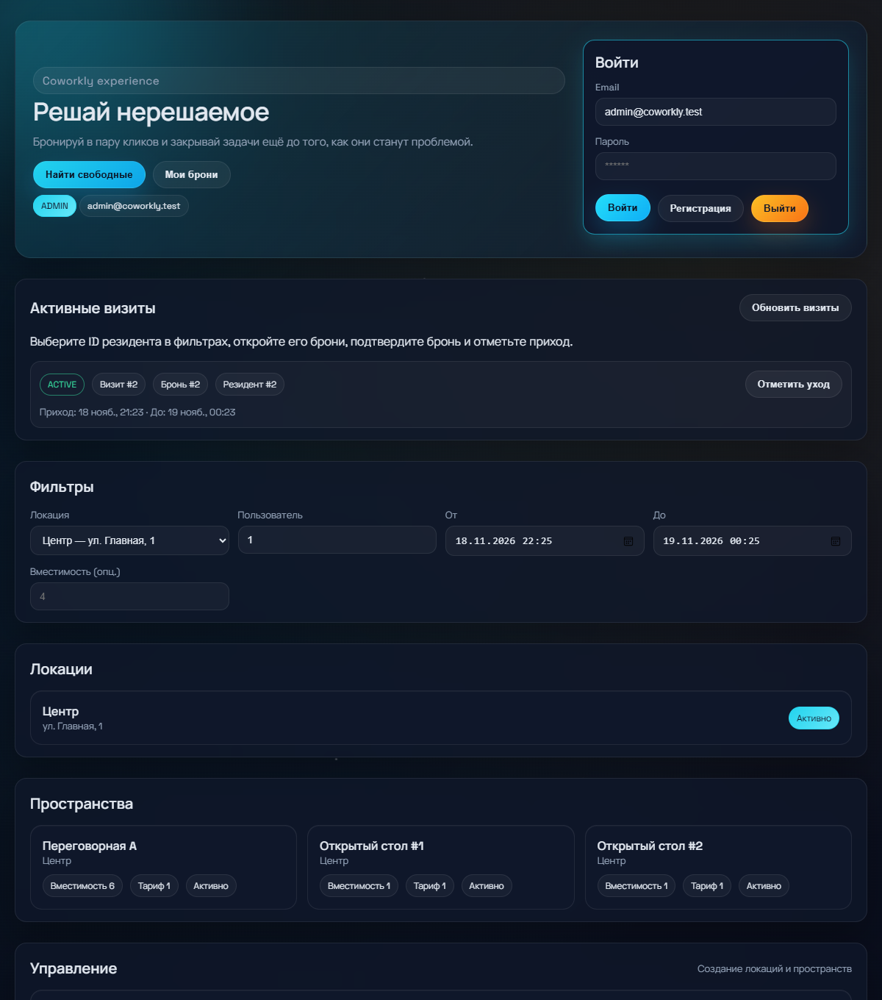

# Coworkly

[](https://github.com/tsostanov/coworkly/actions/workflows/ci.yml)

Coworkly is a full-stack pet project for coworking space management.

The repository contains a Spring Boot backend, a React frontend, database artifacts, and supporting coursework files. The main runnable application lives in the nested `coworkly/` directory.



**Demo:** a resident books a desk, then an administrator confirms the booking and records the visit. Follow the [3-5 minute walkthrough](docs/demo.md) (includes local demo accounts).

## What The Project Does

Coworkly models a small coworking platform with:

- user registration and login
- JWT-based authentication and role-based access
- locations and workspaces
- resident bookings
- admin walk-in bookings
- visit check-in / checkout / extension flows
- penalties
- admin reports

The backend exposes REST APIs for both resident and admin scenarios. The frontend is a separate React application that works against those APIs.

## Main Stack

### Backend
- Java 17
- Spring Boot 3
- Spring Web
- Spring Data JPA
- Spring Security
- Bean Validation
- PostgreSQL
- Flyway
- JUnit 5 / MockMvc / H2 for tests

### Frontend
- React
- TypeScript
- Vite

## Repository Layout

```text
.
|-- coworkly/     # main runnable application
|   |-- src/      # Spring Boot backend
|   |-- frontend/ # React frontend
|   |-- pom.xml
|   `-- README.md
|-- stage2/       # SQL schema, triggers, seed data, ERD artifacts
`-- src/          # additional source artifacts kept at repository root
```

## Important Note

If you want to run, build, or test the actual application, work inside:

```bash
cd coworkly
```

The root of the repository is mostly an umbrella for the full coursework/project history. The active Maven module and frontend app are inside `coworkly/`.

## Implemented API Areas

From the current backend structure, the main API areas are:

- `/api/auth`
- `/api/locations`
- `/api/spaces`
- `/api/bookings`
- `/api/penalties`
- `/api/admin/users`
- `/api/admin/locations`
- `/api/admin/spaces`
- `/api/admin/penalties`
- `/api/admin/walkin`
- `/api/admin/visits`
- `/api/admin/reports`

## Quick Start From A Clean Clone

Requirements: JDK 17+, Node.js 20+, npm, and PostgreSQL (or Docker Compose for the database). The Maven Wrapper is included.

```bash
git clone https://github.com/tsostanov/coworkly.git
cd coworkly
docker compose up -d --wait
```

The Compose service starts PostgreSQL 16 on `localhost:5432`, database/user/password `coworkly`. It stores data in a named volume. If port 5432 is already occupied, use a separate empty database on your installed PostgreSQL instead:

```bash
# Run as a PostgreSQL administrator; enter coworkly as the new role's password.
createuser -h localhost -U postgres --pwprompt coworkly
createdb -h localhost -U postgres -O coworkly coworkly
```

Do not import the coursework scripts from `stage2/`: Flyway creates schema `s367550`, tables, functions and triggers automatically in the empty database. Use a new database for this quick start; existing coursework databases need a separately planned migration.

### Run backend

From the cloned repository root:

```bash
cd coworkly
./mvnw spring-boot:run -Dspring-boot.run.profiles=demo
```

On Windows PowerShell use `./mvnw.cmd spring-boot:run "-Dspring-boot.run.profiles=demo"`. The explicit `demo` profile adds local demo accounts, a location, workspaces and a tariff; omit it to start without fixtures. Repeated demo starts preserve data.

Backend: `http://localhost:8081`. Swagger UI: `http://localhost:8081/swagger-ui/index.html`. OpenAPI: `http://localhost:8081/v3/api-docs`.

### Run frontend

In a second terminal, from the cloned repository root:

```bash
cd coworkly/frontend
npm ci
npm run dev
```

Open `http://localhost:5173`. Vite proxies `/api` to the backend. Continue with the [resident booking / admin visit demo](docs/demo.md).

### Configuration

| Environment variable | Local default |
| --- | --- |
| `DB_URL` | `jdbc:postgresql://localhost:5432/coworkly?currentSchema=s367550` |
| `DB_USER` | `coworkly` |
| `DB_PASSWORD` | `coworkly` |
| `JWT_SECRET` | bundled local demo key (Base64) |

For another database or port, set these variables before starting the backend. For example, in PowerShell: `$env:DB_URL='jdbc:postgresql://localhost:55432/coworkly?currentSchema=s367550'`. The `s367550` schema name is retained for compatibility with the existing SQL API functions. Use private credentials and a separate JWT key for deployments beyond a local demo.

## Build

### Backend

```bash
cd coworkly
./mvnw clean package
```

### Frontend

```bash
cd coworkly/frontend
npm run build
```

## Testing

Backend tests are already configured in the main module:

```bash
cd coworkly
./mvnw test
```

The current test strategy includes:

- unit tests for service-level business rules
- API tests with `MockMvc`
- a Spring Boot smoke test

The test profile uses an in-memory H2 database, so test execution does not require a local PostgreSQL instance.

## CI

The repository includes a GitHub Actions workflow that runs on every push to `master` and on pull requests.

It currently checks:

- backend tests with Maven
- frontend type checking
- frontend production build
- startup on empty PostgreSQL 16 and the resident booking / admin visit smoke scenario

The full demo can also be checked against a running backend with Python 3.10+ (no extra packages):

```bash
python scripts/demo-smoke.py
```

See [clean-clone verification](docs/verification.md) for the recorded local result.

## Database Artifacts

The `stage2/` directory contains SQL and modeling materials, including:

- schema scripts
- triggers and functions
- indexes
- seed data
- ERD-related files

## Notes

- The active application module has its own module-level README in [coworkly/README.md](./coworkly/README.md).
- Database credentials and the JWT key can be supplied through environment variables; bundled defaults and demo accounts are for local review.
