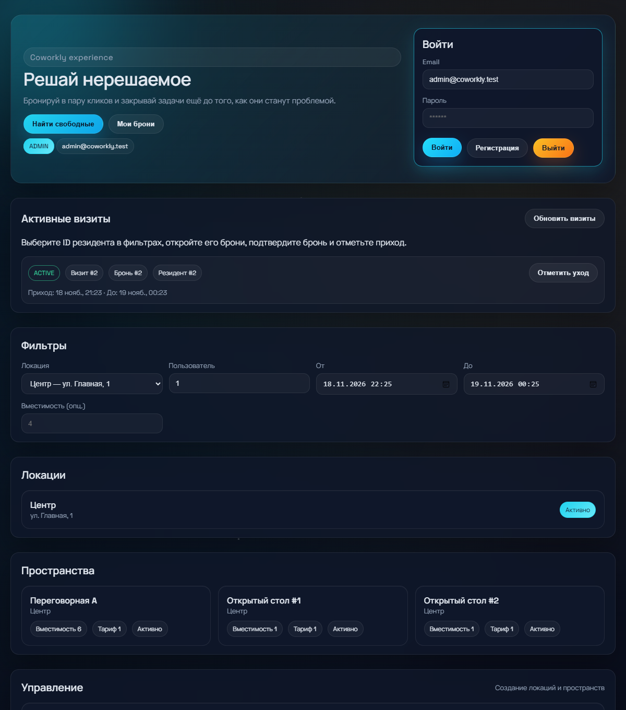

# Демо: резидент бронирует место, администратор отмечает визит

Один сценарий на 3–5 минут. Запустите приложение с профилем `demo` по инструкции в [README](../README.md#quick-start-from-a-clean-clone).

Демо-профиль создаёт локацию «Центр», два рабочих места и переговорную с тарифом 40 ₽/час. Он не создаёт брони заранее. Повторный запуск сохраняет существующие данные и не дублирует учётные записи и места.

| Роль | Email | Пароль |
| --- | --- | --- |
| Резидент | `resident@coworkly.test` | `DemoResident123!` |
| Администратор | `admin@coworkly.test` | `DemoAdmin123!` |

Это открытые данные только для локального демо. Без профиля `demo` эти учётные записи не создаются.

## 1. Резидент бронирует рабочее место

1. Откройте `http://localhost:5173` и войдите как резидент.
2. В фильтрах выберите «Центр». Оставьте предложенный будущий интервал на два часа или задайте другой: конец должен быть позже начала.
3. Нажмите «Найти свободные», затем «Забронировать» у открытого рабочего места.
4. Внизу, в разделе «Мои бронирования», покажите новую бронь: статус `PENDING`, выбранное место, время и сумму **80 ₽** за два часа.
5. Запомните номер брони и значение поля «Пользователь» в фильтрах — это ID резидента. На новой базе он равен `2`.

## 2. Администратор подтверждает бронь и отмечает приход

1. Откройте приложение в другом профиле браузера или приватном окне, чтобы сохранить сессию резидента. Войдите как администратор.
2. В поле «Пользователь» в фильтрах введите ID резидента и нажмите верхнюю кнопку «Мои брони».
3. В разделе «Мои бронирования» найдите записанный номер брони и нажмите «Подтвердить». Статус станет `CONFIRMED`.
4. Нажмите «Отметить приход» у этой брони.
5. Покажите раздел «Активные визиты» под шапкой: запись со статусом `ACTIVE`, номером брони, ID резидента, временем прихода и плановым окончанием. Приход можно отметить заранее, поэтому во время демо не нужно ждать начала интервала.
6. Для завершения нажмите «Отметить уход». Визит станет `COMPLETED` и исчезнет из активных; бронь хранится отдельно и остаётся `CONFIRMED` до автоматического завершения по её времени окончания.

Ожидаемый результат: бронь резидента связана с визитом администратора через один `bookingId`. Отметить приход может только администратор; для неподтверждённой или истёкшей брони и при повторном активном визите сервер вернёт ошибку.



## Автоматическая проверка того же сценария

При запущенном backend с профилем `demo`, из корня репозитория:

```bash
python scripts/demo-smoke.py
```

Нужен Python 3.10+ без дополнительных пакетов (на Linux можно использовать `python3`). Для другого порта: `--base-url http://localhost:8082`.

Скрипт входит обеими ролями, ищет свободное рабочее место, создаёт бронь, проверяет расчёт цены в PostgreSQL и ограничения ролей, подтверждает бронь, отмечает приход и уход. При успехе выводит `"result": "PASS"`, при ошибке завершается с ненулевым кодом. Он создаёт реальную бронь и завершённый визит в демо-базе, выбирая свободный интервал для повторных запусков.

В GitHub Actions job **PostgreSQL Demo** выполняет эту проверку на новой PostgreSQL 16 после checkout и сборки приложения. Локальная проверка чистого клона описана в [verification.md](verification.md).
